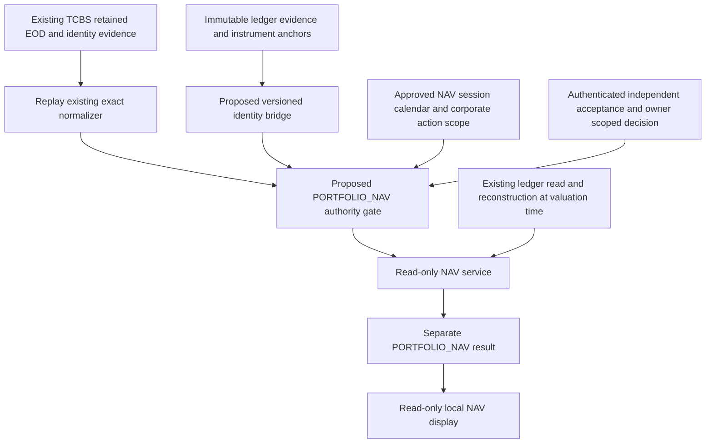

# Proposed NAV source architecture

Status: **READY_FOR_OWNER_REVIEW — DESIGN ONLY**. Date: 2026-10-25, Asia/Ho_Chi_Minh. No design implementation or market approval is authorized by this package.

The owner explicitly approved the prior Current Market Data & NAV Readiness Assessment and requested this architecture design. See OWNER_APPROVAL.json. That approval does not approve this design, any identity bridge, market source, capture, policy or runtime activation.

## Verified existing architecture

INSPECTED_EVIDENCE.json pins the inspected files and original database identity diagnostics. These diagnostics are not accepted mapping records.

|Component|Actual contract and implication|
|---|---|
|SQLite portfolio security|Eleven immutable IDs are FPT, GAS, HPG, MBB, MWG, SSI, TCB, VCB, VHM, VPL and VRE; the security table holds only id/name. Twelve opening transactions and 24 legs use these IDs. No ledger IDs may be rewritten.|
|VN30 master|`docs/02 DATABASE/VN30_MASTER.md` defines durable economic identity, effective-dated identifiers and independent membership. Its header is awaiting user approval; this design does not promote the document to an approval receipt. Membership and similar ticker text cannot certify a ledger-to-market mapping.|
|Retained universe/market identities|The pinned 19 October release and TCBS candidate use UUID security IDs. Release member UUIDs agree with candidate UUIDs. Their existing financial/universe labels do not approve NAV authority or resolve the ledger namespace.|
|TCBS security master|5.11 raw captures supply symbol, codeId, ISIN, tradePlace, secType, status and halt; the normalizer requires one active nonhalted HOSE common-share identity. Older retained database 5.11 records also exist. Exact raw paths, pointers/hashes and matching historical observations are inventoried, without declaring economic continuity accepted.|
|ReferenceData|`src/domain/portfolio/reference.ts` validates effective intervals and overlaps for IDENTIFIER, MEMBERSHIP, COVERAGE and SECTOR. It has no explicit second identity namespace, provider code/ISIN binding, independent acceptance or revocation contract; it is not a complete identity bridge.|
|Market authority|`BoundaryAuthority` and `RetainedMarketAuthority` separate retained bytes from trusted configured approvals, real-source normalization, identity/schema/version checks, request pins, calendar and purpose. A sealed JSON hash is integrity, not actor authentication.|
|Current source|`LocalCurrentSource` parses a bounded manually configured CurrentSource JSON. The source's FORMAL string, quality flag or policy reference is not itself source acceptance. `app/server/current.ts` loads no current source while marketCurrent=false; `requireAcceptedMarketBoundary()` always rejects.|
|CurrentReadService|Checks temporal provenance, exact security IDs, ledger versions, price validity, reference freshness and reconciliation. Its `context()` can feed investment workflows if actionability becomes PASS; it must not be enabled merely to display NAV.|
|NAV arithmetic|`valuePortfolio` computes exact held value + CASH + RECEIVABLE − PAYABLE; missing/stale/conflicting prices block official NAV. Received-time and authority checks belong to callers/PortfolioEngine and the source boundary. Imported inception inputs constrain economic gain/performance separately from point NAV.|

The active historical candidate is for 2026-10-19 with pending independent acceptance and an expired 19–20 October VALUATION window. Newer inactive evidence was identified by the approved assessment but is not selected or approved here. This design has not reacquired current prices or established a new current-session proof.

## Minimum proposed path

All newly named boxes are proposals, not implemented modules. Retain existing Next.js/Prisma/SQLite and TCBS exact parser. Add only a bridge contract/verifier, NAV-specific acceptance/purpose resolution and a small NAV read boundary in later authorized phases. Reuse raw capture and normalization components, not financial/scoring INITIALIZATION acceptance. A NAV-only market envelope must not depend on approving fundamental datasets or marking the general initialization ready. No new provider, service deployment, auth library or database is required for design/offline tests. Prefer immutable content-addressed preparation artifacts for candidate bridge/evidence; they confer no authority. Do not add SQLite tables until operational persistence ownership and audit requirements justify an additive proposal and separate migration authorization.

Use a **separate NAV-only read DTO/service**, reusing the existing ledger and pure valuation arithmetic. Do not synthesize a CurrentSource marked FORMAL, feed LocalCurrentSource, flip global marketCurrent, satisfy CurrentReadService.context(), or unlock review/scoring merely to display NAV. CurrentReadService remains the investment-current-context service under its existing gates. A later shared low-level helper may reduce duplication only if it preserves both boundaries and is independently reviewed.

The NAV result must bind purpose, portfolio ID, valuationAt, calculatedAt, knowledge cutoff, ledger watermark/state hash, bridge hash, accepted market hash, source requests, policy/calendar/normalizer versions, exact eligibleUntil, and current revocation/acceptance proof. It reports component totals, completeness, missing reasons and explicitly false investmentActionabilityAuthorized/scoringAuthorized. Unaccepted retained material remains INDICATIVE_BROKER_VALUE or unavailable, never PORTFOLIO_NAV by relabelling.

Point NAV uses balances and quantities at the completed EOD valuation instant, not today's cash mixed with an older close. If later ledger activity exists, the result may only be an explicitly historical EOD valuation under approved semantics; it must not be presented as the current account. The minimum proposed current mode blocks that promotion until current-account completeness and cutoff consistency are confirmed. Accepted point NAV alone does not claim TWR, CAGR, XIRR, a priced inception baseline or the investment return objective.

## Present stopping condition

All source and acceptance gates remain blocked, auth remains deferred, and the existing unavailable NAV stays unchanged. See IMPLEMENTATION_PLAN.md for separately authorized phases; none is begun by this document.
