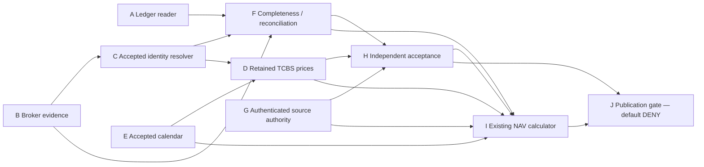

# Read-only integration architecture

2026-10-27 · Phase 3.3 · DESIGN ONLY — NOT IMPLEMENTED / NOT ACCEPTED

Baseline is approved Phase3.2 commit `c84e0f75929135cffb3d541e167d2bd727250cc1`. This package specifies future integration only. No new runtime component, adapter or approval is installed.

All arrows are pinned evidence references, not new mutable financial balances. Implement thin read-only adapters around existing domain/ports. A–I return derived evidence only; no posting/import/approval side effects. Future J needs an independently approved permission contract and release evidence. Broker reconciliation uses the same economic perimeter/T as ledger and price inputs; no mixing dashboard runtime cash with prior EOD holdings.

Operational integration gaps are explicit below. Source references/hashes, schema identities and implemented/proposed distinctions are machine-readable in SOURCE_REFERENCES.json, BASELINE_IDENTITY.json and ARCHITECTURE_MATRIX.json.

## A — Portfolio Accounting Reader

**Existing**: Implemented integrity-checked ledger read in a transaction and existing deterministic reconstructPortfolio; read-only subset used by CurrentNavReadService.

**Missing**: Restrict deployment access to read-only handles; bind real account/perimeter and a consistent revision/facts hash; no write port exposed.

**Input**: portfolioId, ledgerRevision, T, K, approved accounting implementation

**Output**: immutable history, factsHash, stateHash, state(T), supported opening boundary

**Trust boundary**: Saved ledger integrity does not certify external completeness.

**Evidence**: Exact facts/legs, registry method, accepted starting balances and forward coverage

**Failure**: integrity/revision/knowledge mismatch -> NAV_BLOCKED; no projection fallback

**Owner**: Accounting engineer; financial acceptance by distinct reviewer

**Dependencies**: []

Sources: `src/ports/portfolio.ts`, `src/infrastructure/repositories/portfolio-ledger.ts`, `src/domain/portfolio/reconstruct.ts`.

## B — Broker Evidence Reader

**Existing**: Retained broker PDF/API observations and research loaders exist, not a CurrentNavInputProvider or authenticated NAV acceptance reader.

**Missing**: Bounded immutable byte reader/decoder preserving account, times, precision, original fields and conflicts; accepted-source lookup.

**Input**: content-addressed document/capture inventory plus exact account/perimeter and scope

**Output**: BrokerEvidenceBundle proposal, normalized observations with pointers and unresolved discrepancies

**Trust boundary**: Provider data and parsed values are not accepted accounting facts.

**Evidence**: Source bytes/hash, account linkage, capture/document identity, source contract and disjoint field semantics

**Failure**: missing/corrupt/ambiguous/date-only unproved cutoff -> blocked; no balancing record

**Owner**: Broker supplies records; evidence producer prepares; financial reviewer accepts

**Dependencies**: ['A']

Sources: `src/infrastructure/broker-snapshot.ts`, `src/infrastructure/repositories/broker-observations.ts`.

## C — Securities Identity Resolver

**Existing**: Offline immutable bridge structural resolver returns acceptedMapping:false; calculator checks identity/partition/reverse uniqueness.

**Missing**: Revocation-aware accepted continuity resolver for all held units; no accepted mappings currently established.

**Input**: ledger namespace/ID, market namespace/UUID/code/ISIN, venue/class, T/K, bridge pins

**Output**: one exact eligible mapping per economic unit, interval and acceptance evidence; otherwise reasons

**Trust boundary**: Ticker/code coincidence is insufficient; provider ISIN is not independent acceptance.

**Evidence**: Account anchor, market anchor, effective/knowledge intervals and lifecycle witnesses

**Failure**: zero/multiple/overlap/reuse/uncertain CA -> blocked; never rewrite ledger IDs

**Owner**: Identity reviewer distinct from bridge producer

**Dependencies**: ['B']

Sources: `src/domain/nav-preparation/identity.ts`, `src/domain/nav-preparation/contracts.ts`.

## D — Market Price Evidence Reader

**Existing**: Existing acquisition, lossless raw parser, EOD normalizer and replay pipeline; VALUATION-only trusted composition.

**Missing**: Read-only NAV translation/qualification with purpose-specific source/calendar/finality grants; no new client.

**Input**: pinned raw manifests/board/master, accepted mapping, exact session and price policy

**Output**: CurrentNavPriceV1 rows with RAW price/identity/source/CA pins, or unavailable

**Trust boundary**: Technical EOD normalization is neither exchange finality nor PORTFOLIO_NAV source authority.

**Evidence**: Raw SHA-256, request/response lineage, board-date match, unit contract, accepted policy/finality

**Failure**: missing/stale/conflicting/adjusted/revoked/unsupported security -> blocked; no last-price fallback

**Owner**: Market-data engineer prepares; independent market-source reviewer accepts

**Dependencies**: ['C', 'E']

Sources: `api/tcbs.mjs`, `src/domain/market-boundary/tcbs-eod.ts`, `src/infrastructure/market-boundary/tcbs-pipeline.ts`.

## E — Trading Calendar Resolver

**Existing**: Technical 2026 calendar/session helpers exist; accepted NAV calendar absent.

**Missing**: Accepted schedule/exceptions/closure/finality resolver with exclusive next-completed boundary, expiry and revocation.

**Input**: valuation request/time, venue, accepted calendar and NAV price-policy pins

**Output**: session/tradingDate/T/nextCompletedAt/calendar span and normalized-time provenance

**Trust boundary**: Local date or weekday heuristic cannot establish accepted trading session.

**Evidence**: Calendar issuer/source records, exceptional closures, effective/knowledge interval, accepted exact policy

**Failure**: missing exceptions/outside coverage/no completed session -> blocked

**Owner**: Calendar authority reviewer; owner approves NAV scope

**Dependencies**: ['D_SOURCE_POLICY']

Sources: `src/domain/market-boundary/hose-calendar.ts`, `src/domain/market-boundary/completed-session.ts`.

## F — Accounting Completeness Evaluator

**Existing**: NAV ten-dimension gate and unchanged exact full reconciliation; dividend/intake contracts and guards implemented, prepared migrations unapplied.

**Missing**: Evidence-backed evaluator assembling coherent economic completeness, forward continuity and NAV-only addendum, retaining full legacy reconciliation.

**Input**: A/B/C outputs, accepted opening/coverage/claim/action/obligation witnesses atT/K

**Output**: CurrentNavPlanV1 completeness/components/unit partitions and limitations; raw legacy report hash

**Trust boundary**: Import/replay/PASS alone cannot assert completeness; writes are outside this flow.

**Evidence**: No gaps/duplicates, exact reconciled cash/claims/debt/quantity/rights; accounting scope acceptance

**Failure**: unknown liability/claim/continuity/CA/conflict -> blocked even indicative; basis partial only with no economic effect

**Owner**: Accounting producer; financial reviewer validates independently

**Dependencies**: ['A', 'B', 'C']

Sources: `src/domain/current-nav/qualification.ts`, `src/domain/portfolio/reconciliation.ts`, `src/domain/portfolio/dividend-settlement.ts`, `src/domain/portfolio/forward-intake.ts`.

## G — Source Authority Verifier

**Existing**: NavQualificationAuthorityV1 synchronous interface and retained-market trusted bindings exist; real NAV verifier/authenticated records absent. PEC-1C provider/executor neutral contracts remain fail closed.

**Missing**: Server-only verification of authenticated role/scoped grants, bytes, intervals, revocation and supersession; approved trust infrastructure prerequisite.

**Input**: Pinned decision envelope + issuer/reviewer/role-grant audit + exact subject hashes

**Output**: exact NavAuthorityProofV1 projection for requested kind/hash/portfolio/purpose; no extra serialized fields

**Trust boundary**: Local JSON, OS identity, Codex output and synthetic verifier cannot authenticate authority.

**Evidence**: Authentic decision, authorized role, source/interpretation scope, current revocation and audit anchor

**Failure**: unknown signature/issuer/role/revocation/scope -> no proof/block; never auto-create approval

**Owner**: Security/governance reviewer; owner chooses future trust mechanism

**Dependencies**: ['TRUST_INFRA']

Sources: `src/domain/current-nav/contracts.ts`, `src/infrastructure/market-boundary-authority.ts`, `scripts/lib/pec1c_capture.py`.

## H — Independent Acceptance Verifier

**Existing**: Distinct producer/validator fields enforced; only synthetic trusted verifier in tests. No operational independent NAV acceptance.

**Missing**: Verify genuinely distinct authorized human reviewer and exact accepted bundle, not string inequality alone.

**Input**: AcceptanceSubjectV1 proposal, signed/audited reviewer decision and current role/revocation proof

**Output**: technical/financial/methodology acceptance results separately, exact subject hash proofs

**Trust boundary**: Same-person aliases or self-assigned distinct names fail separation of duties.

**Evidence**: Full bound bundle, reviewer identity and role/independence audit, limitations, decision time

**Failure**: missing/self-review/stale/partial/wrong scope -> blocked; technical tests not substituted

**Owner**: Independent financial/system reviewer; no agent/self approval

**Dependencies**: ['F', 'G', 'D', 'E']

Sources: `src/domain/current-nav/contracts.ts`, `tests/fixtures/current-nav.ts`.

## I — Current NAV Calculator

**Existing**: Approved isolated Phase3.2 calculator/read service; immutable manifests and all operational rights false.

**Missing**: Concrete CurrentNavInputProvider and securely prepared authority view; no arithmetic duplication or calculator edits in this phase.

**Input**: CurrentNavRequestV1 + pinned plan/state + injected authority/context

**Output**: CurrentNavResultV1, manifest/input/result/run hashes, qualified/indicative/blocked

**Trust boundary**: QUALIFIED_NAV is calculation qualification, never publication/release authority.

**Evidence**: All dependencies and proofs; exact revision/head checks; calculation version

**Failure**: failed qualification -> null full totals; explicit indication only if coherent; races block

**Owner**: Application architect; separate acceptance reviewer

**Dependencies**: ['A', 'F', 'D', 'E', 'G', 'H']

Sources: `src/application/current-nav/read-service.ts`, `src/ports/current-nav.ts`, `src/domain/current-nav/calculate.ts`, `src/domain/current-nav/qualification.ts`.

## J — NAV Publication Gate

**Existing**: Existing legacy dashboard/current composition and hard independent-market blocker; no CurrentNavReadService composition or NAV gate. V1 output explicitly denies official use.

**Missing**: Proposed separate release-gated publication envelope/view with an explicitly approved contract amendment before any integration.

**Input**: exact resultHash/runHash plus current ledger/evidence/authority heads, destination/purpose and publication/release decisions atP

**Output**: NavPublicationDecisionV1 proposal: DENY by default; explicit scoped destination envelope only after later authorization

**Trust boundary**: No copying qualified arithmetic into legacy current.nav or flipping V1 false flags; no read-driven approval/write.

**Evidence**: Authenticated operational permission + applicable release/M7 evidence + final atomic/current-head check

**Failure**: missing authority/race/expiry/revocation/M7 restriction -> deny/hide official value; no cached stale fallback

**Owner**: Release owner and independent operational validator

**Dependencies**: ['I', 'H', 'G', 'M7_RELEASE', 'PUBLICATION_AMENDMENT']

Sources: `app/server/current.ts`, `app/server/dashboard.ts`, `app/server/market-boundary.ts`, `src/domain/current-nav/contracts.ts`.

## Composition and audit consistency

Future orchestration reads immutable ledger+source-head pins, prepares and verifies all decisions, calculates using the existing service, then rechecks all pins before delivering any view. Across SQLite/files/authority store, there is no existing shared atomic transaction: a final gate must compare one versioned dependency token (ledger revision/facts hash, evidence head, authority/revocation head, calendar/policy/mapping hashes, release head) at publication. A mismatch denies and requires a fresh plan; do not retry with mixed old/new pieces. No long DB write lock or new event engine is needed. If a trustworthy coherent final read cannot be achieved, publication remains blocked.

The synchronous NavQualificationAuthorityV1.verify cannot itself perform live async provider/revocation I/O. Proposed provider orchestration pre-verifies a bounded immutable authority view tied to that dependency token, with expiry, then injects a synchronous lookup. isCurrent(evidenceHead) must represent the entire source/acceptance/revocation dependency set, not just market-file bytes. This is future implementation work requiring review, not a claim that current interface handles live auth.

V1 accepts only SYNTHETIC_TEST/RETAINED_RESEARCH and literal false operational permissions. Preserve it. A future publication envelope cannot override those fields or imply V1 grants release. Owner must explicitly approve versioned operational semantics or retain isolated research-only use.
