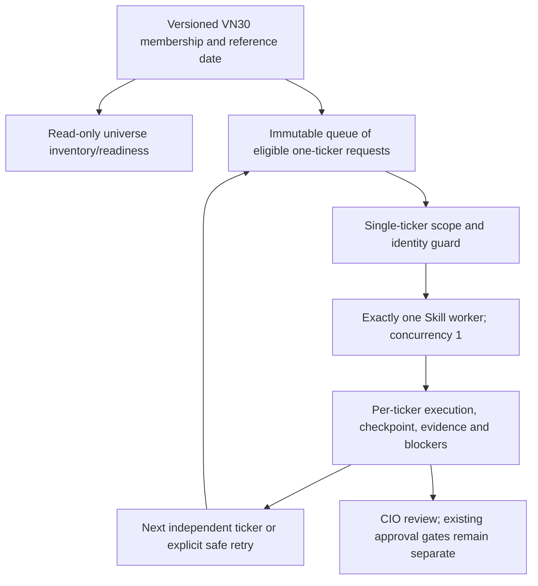

# Single-Ticker Skills + Sequential VN30 Rollout Orchestrator

Owner architecture amendment, 18 November 2026. Scope: planning and reusable foundation only. Existing VNM research, scoring, authority and PUB-04 publication are preserved.

An execution Skill receives one scalar ticker, never a list, ALL, wildcard or a joined/repeated ticker input. The orchestrator owns the multi-ticker queue; it cannot convert the queue into a batch Skill invocation. A queue applies one selected Skill stage to distinct tickers in order. The composite S1–S5 Skill retains its internal stage/sector dependencies without new investment milestones.

The shared guard binds a pinned universe version, reference date, security identity, exchange, Skill, purpose, sector, parameters and candidate reference hashes into deterministic executionId/operationKey. The initial registry reuses the qualified retained 03Aug–15Nov2026 membership version; official/identity/profile/sector bytes are hash-checked. It extracts no VNM financial/source/scoring/publication permission. Reviewed coverage is not a constituent exit date; an uncovered date is UNVERIFIED and cannot be silently extended. Membership validation does not establish historical PIT or financial readiness.

No equivalent orchestrator was found. Existing `rebuild-vn30-downloads.py` is an owner-specific corpus reset/downloader with a worker pool; `build-vn30-lineage.py` aggregates retained issuer artifacts; `refine-pdf-review-queue.py` selects PDF review candidates; workflow/DCA orchestration governs portfolio decisions. None provides this one-ticker Skill contract, durable isolated execution IDs/checkpoints and retry/recovery boundary. They are not registered as rollout workers and are not modified or executed.

The new `vn30-rollout-orchestrator` reuses existing Skills and their economics/admission logic. Its CLI only supports prepare, inventory, plan and status. A Python host foundation supports one callback at a time with a store-wide nonblocking lock. No live callback, command launcher, financial pipeline, scoring adapter, deployment or publication adapter is installed. Tests use synthetic callbacks and temporary stores only.

One configured store per repository contains immutable queue plans and per-ticker request/attempt directories. Atomic checkpoints, stable operation keys and immutable result hashes support safe resume. A worker error, interrupted attempt or corrupt issuer result does not rewrite completed tickers. Ambiguous external effects block retry until reconciled unless a trusted adapter guarantees idempotence for that exact operation key. State-root separation is workflow isolation, not a sandbox for arbitrary Python callbacks.

All workflow result permissions are false. COMPLETED means a bounded step completed, not an approved analyst assessment, formal admission, numeric score, deployment, publication, trade or PIT qualification. Actual consumers retain their existing trusted approval/source/time/revocation gates. Shared standing-provider policy remains reusable only within its own approved scope with independent validation of each issuer's observation; another ticker never inherits VNM admissions, share carry-forward evidence, assessment or PUB-04 permission.

The five existing Skill specifications now require the shared invocation envelope. Hash-pinned CaféF and S4 processors are preserved byte-for-byte as compatibility/replay workers; their direct paths are not active Skill bypass entrypoints. Manual PDF/S1–S5 work follows the same guard. Sector selection, BANK/equity models, industrial ROIC/FCFF and other M3/M4 rules remain in the original contracts; there is no VNM parameter template or automatic band/valuation assignment.

Read [implementation plan](IMPLEMENTATION_PLAN.md), [validation plan](VALIDATION_PLAN.md), [Skill audit](SKILL_AUDIT.json) and the [queue contract](../../../../skills/vn30-rollout-orchestrator/references/queue-contract.md). No production execution is authorized by this foundation. STOP for CIO review.
